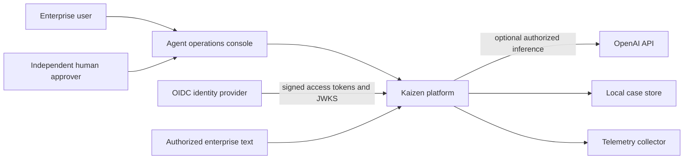
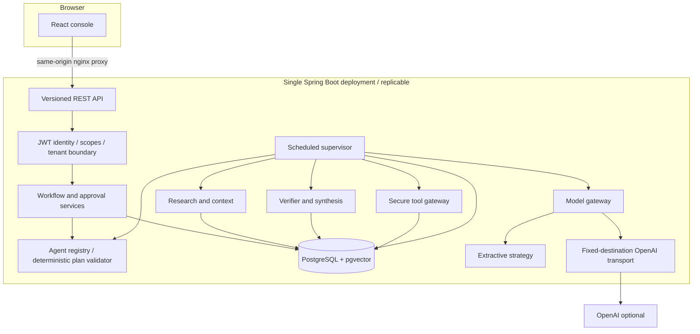
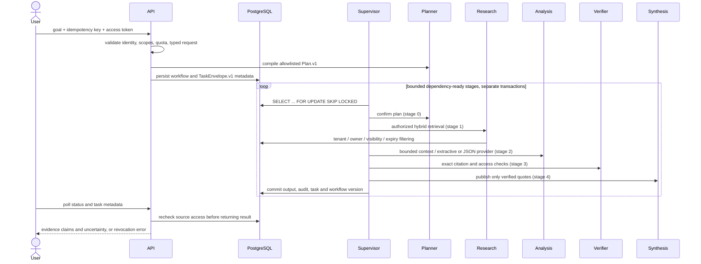
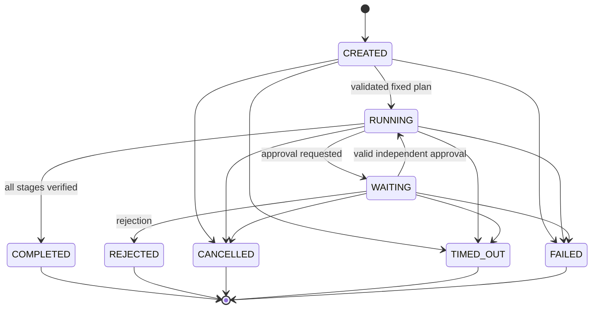
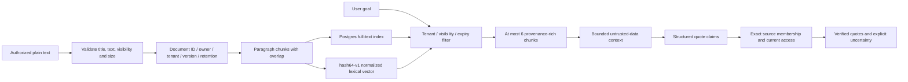
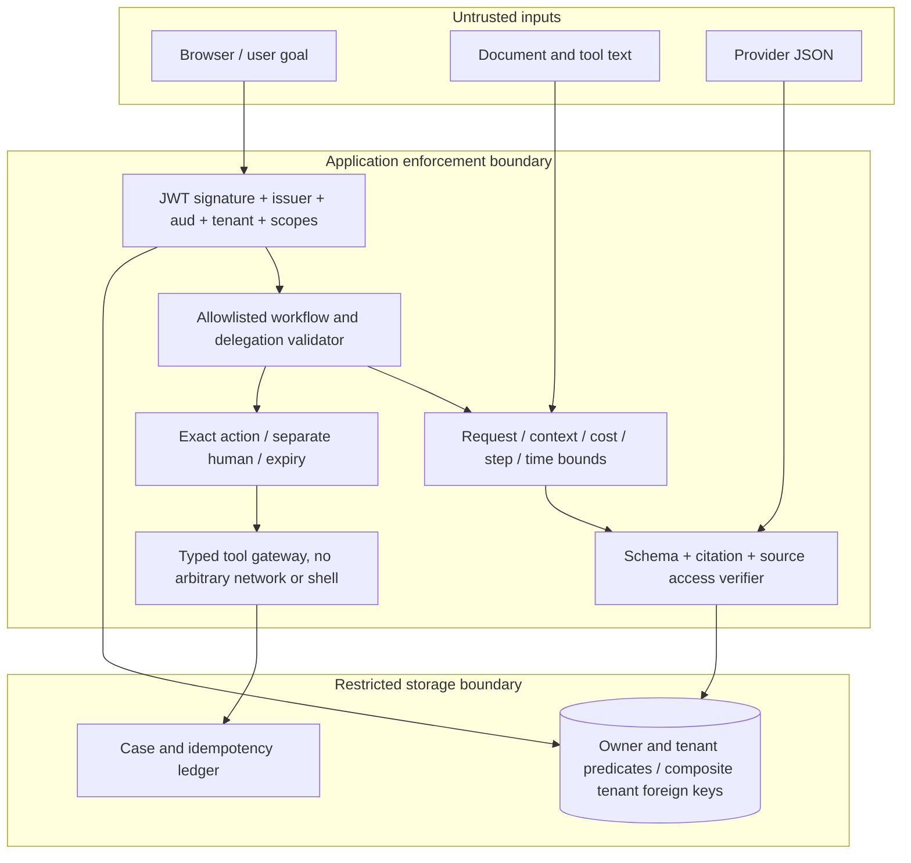
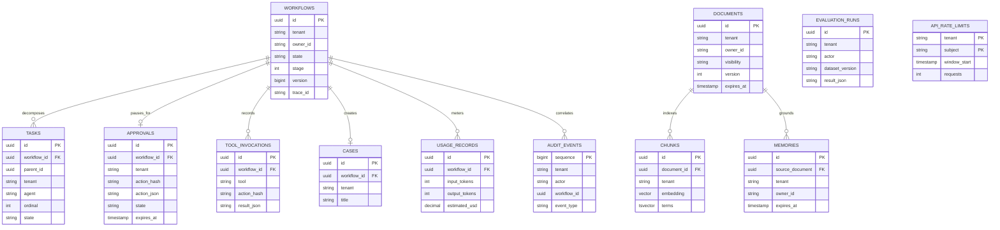
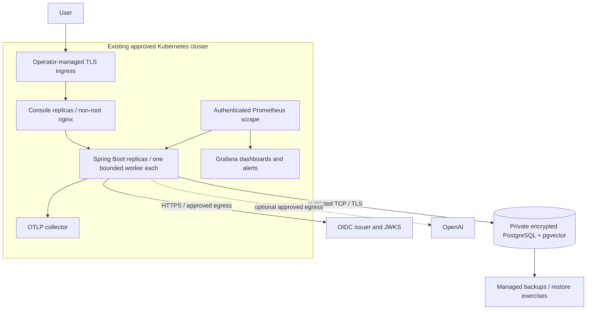

# Architecture and implementation boundaries

## Implementation plan

1. Foundation: Java 21, Spring Boot, PostgreSQL/pgvector, Flyway, OIDC/local auth, versioned contracts.
2. Runtime: code-reviewed registry, deterministic bounded planner, persisted task envelopes and validated state transitions.
3. Orchestration: supervisor ticks one dependency-ready stage per transaction, verified final evidence.
4. Tools: allowlists, local write ledger, separate-human exact-action approval and cancellation.
5. Knowledge: text ingestion, chunks, full text + lexical vectors, private/tenant visibility, source-bound memory and revocation.
6. Reliability/security: row locks, crash rollback, retries, deadlines, tenant predicates, request and execution quotas, adversarial tests.
7. Interface/operations: React console, usage, audit, trace continuity, metrics and alerts.
8. Delivery: policy/workflow evaluation, local containers, browser/restart tests, deployment foundation and readiness gaps.

These milestones describe the implemented sequence; not all requested enterprise extensions are present. The report is authoritative about verification and gaps.

## System context



## Physical containers and internal components



The frontend boundary separates browser assets from credentials and execution. PostgreSQL is separate because state, source access, idempotency, and approvals must survive application restarts. Execution shares the application deployment to avoid an unnecessary broker/service boundary. Replicas coordinate using row locks; each replica has one scheduled worker. Provider egress is an explicit trust boundary. There is no Kafka, Redis, Temporal, S3, MCP, or external A2A service in this version.

## Knowledge workflow sequence



The planner is deterministic application code, not an autonomous model. All specialist calls are synchronous, typed handoffs inside the process. Task metadata includes IDs, workflow/parent, source/destination role, tenant, schema version, deadline, attempt and correlation ID; authorization is inherited only from a validated workflow and capability allowlist. Payloads are stored as workflow context and task outputs. No unrestricted agent-to-agent entrypoint exists.

## Tool and approval sequence

```mermaid
sequenceDiagram
 actor Requester
 actor Approver
 participant API
 participant Supervisor
 participant Gateway
 participant DB
 Requester->>API: CREATE_CASE + exact Action.v1
 API->>DB: store immutable proposed action
 Supervisor->>DB: request approval with SHA-256 action fingerprint
 Supervisor->>DB: WAITING, commit
 Approver->>API: approve exact hash
 API->>API: verify approval scope and distinct subject
 API->>DB: lock workflow then approval; validate state/expiry/hash
 API->>DB: APPROVED + RUNNING, commit
 Supervisor->>Gateway: case.create (allowlisted execution role)
 Gateway->>DB: lock owner-scoped workflow; check exact unexpired approval
 Gateway->>DB: case + invocation result + audit + completion in transaction
 Note over DB: All effects commit together or all roll back
 Supervisor-->>Requester: case ID available through status API
```

External integrations must not reuse the local transaction claim. Remote actions require destination idempotency plus reconciliation, or an outbox and a state machine for ambiguous outcomes. Automatic blind retries of non-idempotent remote effects are prohibited. Remote tools are not implemented.

## Workflow state machine



Task CREATED → RUNNING → COMPLETED commits as one bounded stage; approval tasks commit WAITING. Failure handling writes FAILED, retry scheduling or cancellation in a separate version-checked transaction after the stage rolls back. There are no hidden in-memory completion dependencies.

## Data flow and provenance



Vectors are deterministic lexical features; search requires a full-text match and uses cosine similarity in ranking. This is not dense semantic retrieval. Text is chunked at paragraph boundaries, with 1,000-character windows and 100-character overlap for long paragraphs. Document update currently means delete/re-ingest with a new ID; in-place version history, rich formats, learned embeddings and reranking remain gaps.

## Trust boundaries



The database is trusted infrastructure. Application tenant predicates and composite FKs are implemented; PostgreSQL RLS and a separate queue service identity are not. Local mode has exactly one fixed tenant and two explicitly configured tokens. Production claims are never sourced from arbitrary client headers.

## Database relationships



Tenant/user/role/policy identities come from OIDC claims and application policy. Agent/workflow/tool definitions are code-versioned, not database-managed resources. Those requested management entities/APIs remain an extension rather than empty tables.

## Deployment architecture



Kubernetes manifests are a fail-closed foundation; ingress, collector installation, monitoring credentials, private networking, workload secrets and endpoint allowlists are environment inputs. Terraform provisions only RDS in supplied private subnets and security groups, using a managed master secret. It does not deploy EKS or provision resources automatically.

## Operational limits

At most 20 active and 200 new workflows per tenant/hour; 300 authenticated API requests per subject/minute; 1 MiB HTTP body; 1,000 retained documents per tenant; 6 evidence chunks; 6 maximum plan steps; 10-minute workflow/approval deadline. Worker stages have a 25-second transaction timeout, database statements 20 seconds, lock waits 2 seconds, provider end-to-end response 15 seconds and response limit 64 KiB. Provider transient errors retry at 2/4 seconds with at most three attempts. No autonomous repair loops or cross-provider fallback occur. One scheduled worker per replica is the bulkhead; HTTP/database pools and pod resources are bounded. There is no SLO-derived autoscaler yet.

Framework references checked during implementation: [Spring JWT validation](https://docs.spring.io/spring-security/reference/servlet/oauth2/resource-server/jwt.html), [Spring Boot tracing](https://docs.spring.io/spring-boot/3.5/reference/actuator/tracing.html), [PostgreSQL SKIP LOCKED](https://www.postgresql.org/docs/17/sql-select.html), [OpenAI Chat Completions contract](https://developers.openai.com/api/reference/resources/chat/subresources/completions/methods/create). Live tests, not these references alone, determine integration readiness.
